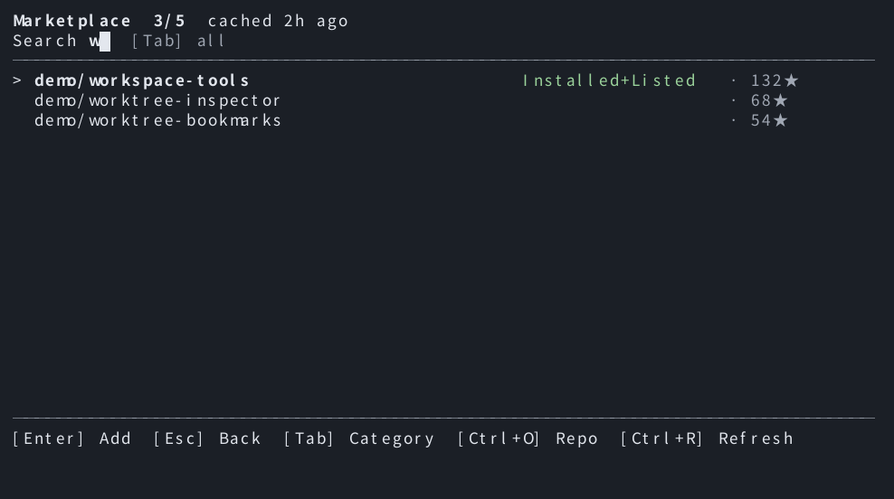

# v0.45.0 candidate verification

The candidate was built from main at `b4ba1749e7b5cdebf436a0dc43351387dcee221a`.
The manifest and Cargo version still identify v0.44.4. When publication is approved,
the existing release script stamps the new version and creates the corresponding tag.

## Terminal captures

These 80×24 captures came from the actual main build running the offline demo fixture.




Use the [demo recorder guide](demo.md) to recreate the captures or record the
candidate workflow and individual interactions.

## Performance

Both versions used a locked release build, a 120×24 Linux x86_64 PTY, a fake Herdr
process and the same 1,000 synthetic Marketplace entries. Two warm-up runs were
discarded. This was one paired comparison against v0.44.4.

| Metric | Samples per version | v0.44.4 median / p95 | Candidate median / p95 |
| --- | ---: | ---: | ---: |
| Startup to first frame | 30 | 5.693 / 6.192 ms | 5.960 / 6.815 ms |
| Search input to completed frame | 90 | 0.228 / 0.554 ms | 0.298 / 0.803 ms |

Both binaries can be passed to the candidate's benchmark from the same checkout.

```sh
python3 scripts/benchmark-pty.py /path/to/v0.44.4/herdr-lazy
python3 scripts/benchmark-pty.py target/release/herdr-lazy
```

A separate run measured the candidate's refresh completion with 30 staggered
fake downloads (60–208 ms). From the downloader's output-ready timestamp to the
completed browser frame, the median was 19.407 ms and p95 was 30.689 ms. This
measures the interface's response after data is ready.
