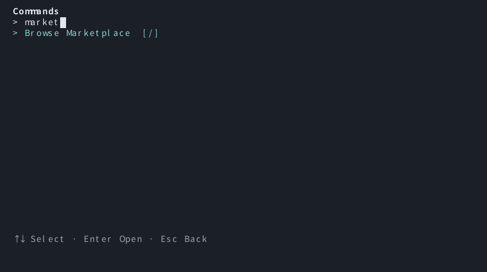
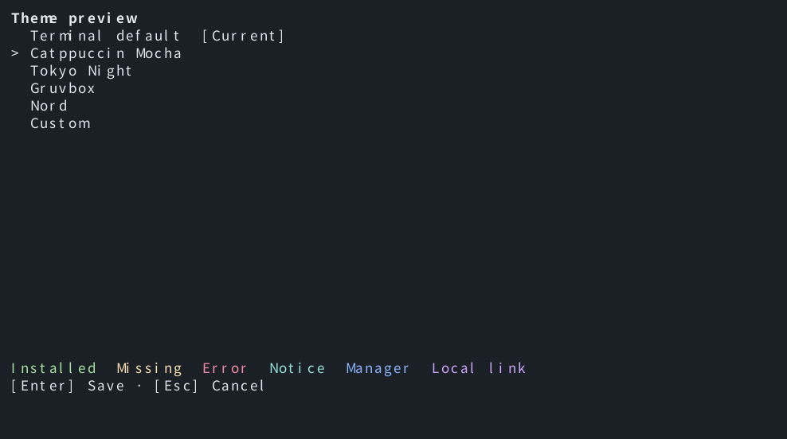

# v0.45.0 candidate verification

The final executable source before the release stamp is [`9c8d65853c0b5015c84b32360d9771388c86a79c`](https://github.com/natori-hrj/herdr-lazy/commit/9c8d65853c0b5015c84b32360d9771388c86a79c).
The only executable source change since [Astra's reviewed candidate](https://github.com/natori-hrj/herdr-lazy/commit/1b1877d4019750ae6bfadec5d2c20450e762f3e9)
is the CLI version reporting added by [#125](https://github.com/natori-hrj/herdr-lazy/pull/125). The audited
security sources and dependency versions are unchanged. See the
[candidate changelog](../CHANGELOG.md) for the release changes.

## Terminal captures and recordings

These 80×24 captures use the security-integrated main build `45b84cbc3044eb3848c19007812a2b04eaab9399`
with fictional plugin data. The subsequent CLI version flags leave the TUI unchanged.

Download the recordings and replay them with `asciinema play`.

- [Manage, details, and Marketplace workflow](recordings/v0450-workflow.cast)
- [Command palette](recordings/v0450-palette.cast)
- [Theme preview and persistence](recordings/v0450-theme.cast)
- [Cached Marketplace during refresh](recordings/v0450-cached-marketplace.cast)

The [demo guide](demo.md) includes the recording commands and theme captures.

## Performance

Baseline: v0.44.4 (`065f6cdb20b73d432435c57783c99ac5c9f3cf81`). Measured candidate: `45b84cbc3044eb3848c19007812a2b04eaab9399`.
Both are locked Rust 1.99.0 release builds measured in a 120×24 Linux x86_64 PTY
(kernel 7.2.15-4-omarchy) on an AMD Ryzen AI 5 PRO 340 with a stub Herdr and
1,000 fictional entries.
Each version completed 30 measured sessions with the execution order reversed
on alternating pairs and two initial pairs discarded. Search used three
keypresses per session with a fresh cache. Marketplace timing began with
`/` against the same stale cache and a local downloader with a fixed 250 ms
delay and distinct updated content.

| Metric | Samples per version | v0.44.4 median / p95 | Candidate median / p95 |
| --- | ---: | ---: | ---: |
| startup | 30 | 6.793 / 7.637 ms | 7.223 / 8.450 ms |
| search | 90 | 0.426 / 0.691 ms | 0.427 / 0.746 ms |
| Marketplace first frame | 30 | 253.741 / 254.466 ms | 2.123 / 2.357 ms |
| Marketplace completion | 30 | 253.741 / 254.466 ms | 280.358 / 281.535 ms |

The synchronous baseline first shows the refreshed catalog after the download.
The candidate presents the existing catalog immediately, then draws the new
catalog in a later frame. The completion measurements include the downloader
delay and the interval before drawing. Startup and search are single-machine
observations under this fixture. The comparison does not estimate live HTTPS
latency or promise gains across systems.

Use `scripts/benchmark-pty.py` to repeat the fresh-cache startup and search
measurements. The Marketplace setup used the same fixture, a stale cache mtime,
a local curl stub and timestamps for the first complete Marketplace footer
and the first complete footer with the distinct refreshed row.

## Verification and rehearsal

- [Security-integrated main CI](https://github.com/natori-hrj/herdr-lazy/actions/runs/45957154644)
  and [CLI-integrated main CI](https://github.com/natori-hrj/herdr-lazy/actions/runs/45960106155) cover
  Linux musl, macOS arm64, Windows MSVC, Rust 1.78.0, and RustSec.
- Linux local verification covered Stable and Rust 1.78.0 tests, formatting,
  strict Clippy, locked GNU and musl builds, and PTY interaction and security
  regressions. The macOS and Windows results are from CI.
- Offline regressions covered bounded JSON nesting, bounded cache reads,
  invalid UTF-8, response size, shared downloader deadlines, cache recovery,
  direct-child reaping, and terminal restoration.
- The isolated rehearsal stamped Cargo.toml, Cargo.lock and the plugin
  manifest to 0.45.0. GNU and musl archives passed SHA-256 verification,
  extraction and a CLI smoke test. Both extracted binaries printed
  `herdr-lazy 0.45.0` with `--version` and `-V` in an empty environment.
- Release packaging checks that Cargo and the plugin manifest agree and that
  a release tag names that version. Native build jobs also run the packaged
  binary's version option. Intel macOS is cross-built on ARM, so the native
  execution check is omitted for that artifact.

## Known limitations

Astra approved the three security fixes with notes. Herdr CLI output and local
input limits ([#121](https://github.com/natori-hrj/herdr-lazy/issues/121)) and compound Unicode display width
([#116](https://github.com/natori-hrj/herdr-lazy/issues/116)) remain deferred. Downloader cleanup covers direct
children during handled failures. Descendant-tree cleanup and cleanup after
forced application termination remain outside this candidate.
