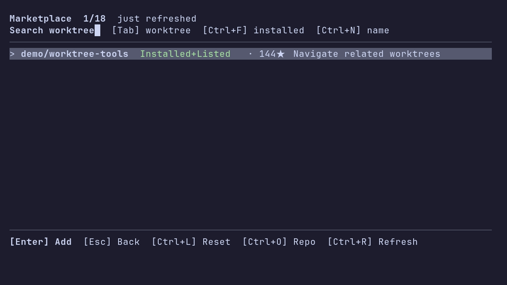
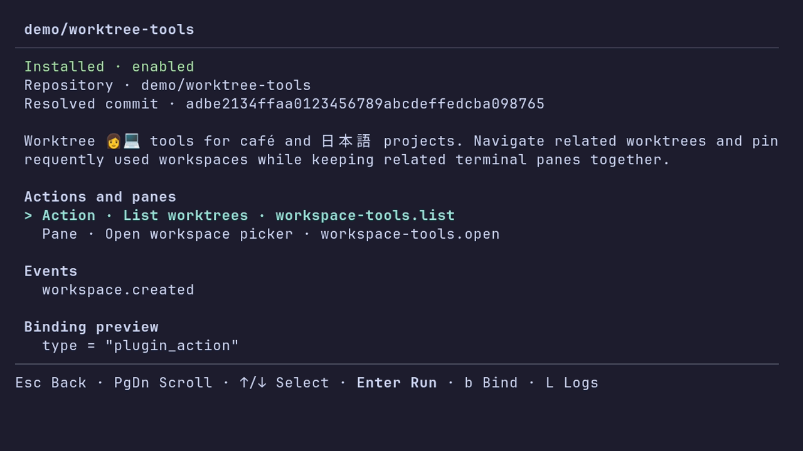

# herdr-lazy v0.46.0

Marketplace discovery combines text search with category and installation filters.
Type `worktree` in Marketplace, then use `Tab` or `Shift+Tab` to change category,
`Ctrl+F` to cycle installation filters, and `Ctrl+N` to sort by name or stars.
`Ctrl+L` clears the query and filters and restores stars order.

Manage and Marketplace adapt their columns to the visible rows. The focused row
has a background that keeps status colors visible. The command palette keeps key
hints next to the results, and the theme picker previews each theme on a plugin
row. Terminal text clipping and wrapping keep grapheme clusters together and
measure width in terminal cells. [Full changelog](../CHANGELOG.md)

Requires Herdr 0.9.0 or later. Run `herdr-lazy --version` or `herdr-lazy -V` to
identify your build.

## Terminal recording

The local Linux x86-64 musl build stamped 0.46.0 drives this 1280×720 VHS
recording with an isolated, fictional catalog. [GIF](media/v0460/demo.gif) ·
[MP4](media/v0460/demo.mp4) · [Recording instructions](demo.md)

[Reset to the full catalog](media/v0460/discovery-reset.png) ·
[No results and the reset hint](media/v0460/discovery-empty.png) ·
[Cached results during refresh](media/v0460/marketplace-refresh.png)

The description is clipped in Manage and wraps in Details. This emulator
renders the woman-technologist emoji sequence as two glyphs.

[Manage](media/v0460/manage.png) · [Help](media/v0460/help.png) ·
[Command palette search](media/v0460/command-palette-search.png) ·
[Theme preview](media/v0460/theme-selection.png) ·
[Manage after applying Nord](media/v0460/manage-themed.png)

## Performance

The comparison uses the published v0.45.0 Linux x86-64 musl binary
(source `f4d9d8e8590735ef5ac17ae6193e8848158b6844`), the integrated core
before the Unicode changes (`fecfaa79d5d05d01c2edf3eb0c4ddb56e3608774`),
and the integrated product candidate measured before the 0.46.0 version stamp
(`e148c1a74ae76f2da247145e1c4a96b19bfabaf6`).

The host ran Linux 7.2.15-4-omarchy x86_64 on an AMD Ryzen AI 5 PRO 340
with Radeon 840M. Runs were pinned to logical CPU 4, using the same 120×24 PTY
and fixture of 2,108 fictional entries. The local refresh stub had a fixed 50 ms
delay. The host toolchain was rustc 1.99.0 (`b940084d7`, 2026-09-28).
The harness used two warmups per binary. Each table cell gives median / p95.

| Metric | Samples per binary | v0.45.0 | Integrated core | Integrated candidate |
| --- | ---: | ---: | ---: | ---: |
| First frame (ms) | 30 | 9.083 / 11.498 | 9.061 / 11.008 | 8.898 / 10.657 |
| Marketplace opening (ms) | 30 | 6.283 / 7.169 | 5.567 / 6.305 | 5.352 / 5.818 |
| Search input to frame (ms) | 90 | 1.673 / 1.781 | 0.784 / 0.850 | 0.825 / 0.941 |
| Refresh key to frame (ms) | 30 | 82.745 / 84.086 | 80.747 / 81.828 | 80.513 / 81.601 |
| Peak RSS (KiB) | 30 | 5,352 / 5,412 | 5,398 / 5,444 | 5,588 / 5,608 |
| Parent process CPU (%) | 30 | 34.518 / 36.058 | 33.678 / 35.633 | 32.999 / 35.681 |

The candidate had lower search latency than v0.45.0 in this fixture, with modestly
higher peak RSS. The stripped candidate binary was 1,541,024 bytes, up 61,440
bytes from the integrated core and 135,160 bytes from the published binary.
The timings end at PTY output. They exclude emulator paint, real Herdr workloads,
and live network latency. The table applies to this Linux host and fixture.

## Verification

Release preparation built the stamped binary with Cargo's locked Linux musl target
and verified both version flags. The VHS recording exercises Manage, Help, command
palette search, cached Marketplace refresh, discovery filters and reset, Details,
and saving Nord with fixture data. Terminal fonts, emoji shaping, ambiguous-width
characters, and contrast in customized ANSI palettes can vary by emulator.

The pre-stamp product candidate ran native CI tests on Linux x86-64, Linux ARM64,
macOS ARM64, and Windows x86-64. CI also built the macOS Intel target on ARM64.
The visual and PTY evidence described here is from Linux. Final release build,
packaging, and installation checks apply to the stamped release commit.
[Pre-stamp candidate CI](https://github.com/natori-hrj/herdr-lazy/actions/runs/46077991683)

[v0.45.0 recordings and verification](release-v0.45.0.md)
